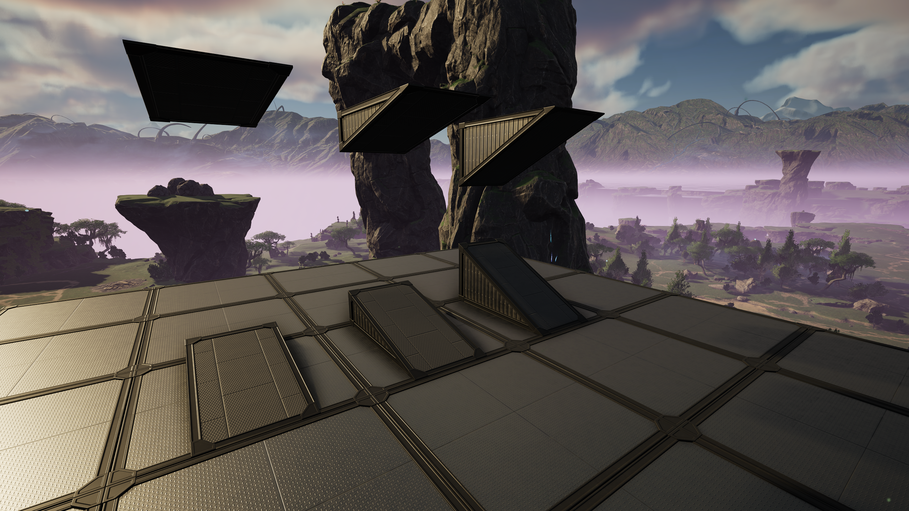

## Version 1.2.0

**Version number:** `v1.2.0`\
**Released on:** `10/11/2026`

---

### Changes

- Added **Half Ramp Pack** (1m, 2m, 4m) for all materials.
- Added **Inverted Half Ramp Pack** (1m, 2m, 4m) for all materials.
- Updated cost of the **Corner Ramp Extensions Pack** and the **Inverted Corner Ramp Extensions Pack** from 3 to 4 coupons.

### Fixes

- [#14](https://github.com/Spokloo/Satisfactory-MoreBuildables-Mod/issues/14): Fixed inconsistent capitalization in schematics names.

---

### Screenshots

#### Half Ramp Pack

*Overview of all the FICSIT half ramps. Available for all materials*

---

### Known bugs

- [#9](https://github.com/Spokloo/Satisfactory-MoreBuildables-Mod/issues/9): Inverted Inner/Outer Corner Ramps don't show the FICSIT material when it is the first unlocked foundation within its subcategory. If you encounter this bug, unlock another type of foundation in the same subcategory and it should fix itself.
- [#11](https://github.com/Spokloo/Satisfactory-MoreBuildables-Mod/issues/11): Patterns don't show up properly on all added foundations.

---

### Notes

If you encounter any bugs that are not listed in the `Known bugs` category, feel free to send me a DM on discord at `@spokloo` to let me know or open an issue on the [GitHub repo](https://github.com/Spokloo/Satisfactory-MoreBuildables-Mod/issues). You can also DM me if you have any suggestions to add to this mod.
